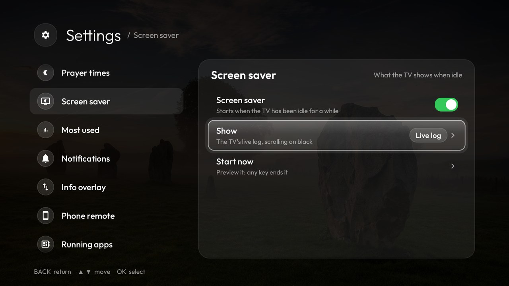
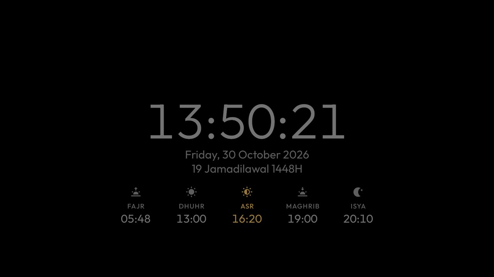
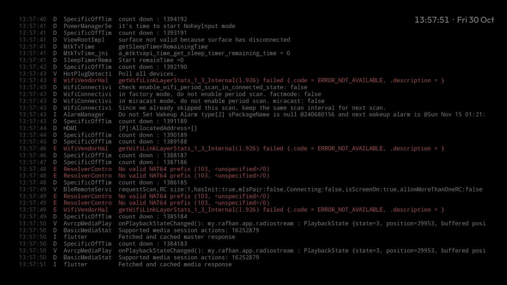
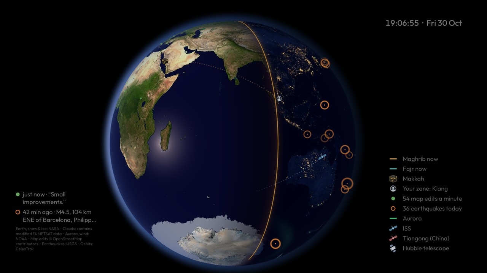

# Mi TV debloat + Apple TV style launcher

A fast, minimal home screen for **Android TV and Google TV** (Android 8.0 or newer), with prayer times, a live system card, Now Playing, a running-apps screen, a phone remote and a live globe screen saver. It was built on a Xiaomi Mi TV, which was also [debloated](docs/xiaomi-debloat.md).

**Install it on your TV:** [Windows](docs/install-windows.md) · [macOS](docs/install-macos.md) · [Linux](docs/install-linux.md) · [with an AI agent](docs/install-with-ai-agent.md)

<table>
  <tr>
    <th width="50%">Before: stock Android TV home</th>
    <th width="50%">After: this launcher</th>
  </tr>
  <tr>
    <td width="50%"></td>
    <td width="50%"></td>
  </tr>
  <tr>
    <td valign="top">Rows of recommendations and sponsored content, with your apps squeezed into one line.</td>
    <td valign="top">Your apps, the time and what matters at a glance: prayer times, most used apps, a live system card and Now Playing, over a calm wallpaper.</td>
  </tr>
</table>

## Demo

https://github.com/user-attachments/assets/8c54b279-a93a-4732-a06b-bfd6f9cd3b32

Recorded on the TV (2 minutes, no sound): the dock's name and glow following focus, Now Playing, the running-apps screen and its hold-OK menu, Settings with wallpapers previewed as you move, the prayer zone list, and moving an app in the dock.

https://github.com/user-attachments/assets/fefd8d49-178f-4e7a-b011-14a44a562c13

The Globe screen saver (21 seconds, no sound): Settings → Screen saver → **Start now**, then the Earth turning as it is right now, with the Maghrib line passing Malaysia, Makkah and the qibla, the sun's glint on the sea, city lights, the day's earthquakes, map edits as people save them, and the ISS and Tiangong overhead.

## Features

<table>
  <tr>
    <td width="50%"></td>
    <td width="50%"></td>
  </tr>
  <tr>
    <td valign="top"><b>Home</b>: big clock with the date and Hijri date, today's prayer times with a countdown, your most used apps this week, a system card (CPU, RAM, storage, network, USB debugging), Now Playing with cover art and controls, and an app dock you arrange yourself.</td>
    <td valign="top"><b>All apps</b> (Down from the dock): 5 per row (6 or 7 in Settings, the dock follows), most used first (all time), with a glass focus highlight that springs from tile to tile. Hold OK on any app to add it to the dock.</td>
  </tr>
  <tr>
    <td width="50%"></td>
    <td width="50%"></td>
  </tr>
  <tr>
    <td valign="top"><b>Running apps</b> (Up from the top bar): what's running, how much memory each app uses and what it's doing. OK force-closes; hold OK to hide an app from the list.</td>
    <td valign="top"><b>Settings</b> (the gear): prayer zone (all 60 JAKIM zones), azan and prayer reminders, which cards show, 12/24-hour clock, wallpaper, the Most used week, apps per row, the screen saver, what the bell tells you, the phone remote, and more. Changes apply straight away.</td>
  </tr>
  <tr>
    <td width="50%"></td>
    <td width="50%"></td>
  </tr>
  <tr>
    <td valign="top"><b>Your dock, your order</b>: hold OK on a dock app for <b>Move</b> (◀ ▶, then OK to place), <b>Remove from dock</b> or <b>Open</b>; hold OK on any app in the grid to add it. The phone remote can edit the dock too.</td>
    <td valign="top"><b>Hide apps you never close</b>: hold OK on a running app and choose <b>Hide from this list</b>. Hidden apps wait under a "Hidden apps" row at the bottom, and Settings → Running apps brings them back.</td>
  </tr>
  <tr>
    <td width="50%"></td>
    <td width="50%"></td>
  </tr>
  <tr>
    <td valign="top"><b>Wallpapers</b>: move to preview, OK to set. Add your own from the phone remote: Settings → Wallpaper → Your photo.</td>
    <td valign="top"><b>Settings → Screen saver</b>: switch it on or off, choose Prayer time, Live log, Globe or any other screen saver on the TV, and preview it with Start now. With Globe chosen, each of its layers has a switch.</td>
  </tr>
  <tr>
    <td width="50%"></td>
    <td width="50%"></td>
  </tr>
  <tr>
    <td valign="top"><b>Screen saver: Prayer time</b>: a big clock with seconds, the date, the Hijri date and today's prayer times, the next one in amber.</td>
    <td valign="top"><b>Screen saver: Live log</b>: the TV's log as it happens, errors in red and warnings in amber. All the screen savers are on black and keep moving so nothing burns in (<a href="docs/features.md#screen-savers-prayer-time-and-live-log">more</a>).</td>
  </tr>
  <tr>
    <td colspan="2"></td>
  </tr>
  <tr>
    <td colspan="2" valign="top"><b>Screen saver: Globe</b>: the Earth as it sits in space right now, lit by the real sun, turning once every 2 minutes. On it: where it's Maghrib and Fajr right now, Makkah and the qibla from your zone, city lights, the sun's glint on the sea, snow and sea ice, the aurora, map edits as people save them, the day's earthquakes, and the ISS, Tiangong and Hubble where they are now. Clouds and moving wind can be switched on too. The remote's arrows turn it (<a href="docs/features.md#globe">more</a>).</td>
  </tr>
  <tr>
    <td colspan="2" valign="top">
      <b>Also:</b>
      <ul>
        <li><b>Azan</b> at each prayer time with a banner over any app, plus a silent reminder a few minutes before (you choose how early).</li>
        <li><b>Wallpapers</b>: Bing's photo of the day (scenery only, no people), seven photos from Wikimedia Commons, previewed as you move through the list, plus your own pictures from a <code>Wallpapers</code> folder.</li>
        <li><b>Notifications bell</b>: new TV Home versions (update from the bell in one click), Play Store updates, new HDMI devices, Bluetooth devices and low memory.</li>
        <li><b>Connection status</b>: a banner over any app when Wi-Fi drops or loses internet.</li>
        <li><b>Info overlay</b> over apps (optional): network speed, uptime, a clock with seconds and time since you left the home screen; hidden on the home screen.</li>
        <li><b>Inputs</b> menu for HDMI 1–3, AV and Live TV.</li>
        <li>Light: a 0.51 MB app that starts about 3× faster than the stock launcher, uses about a third less memory after navigating, and has a quarter of its janky frames (<a href="#benchmark">benchmark</a>).</li>
      </ul>
    </td>
  </tr>
</table>

<table>
  <tr>
    <td align="center" width="33%"></td>
    <td align="center" width="33%"></td>
    <td align="center" width="33%"></td>
  </tr>
  <tr>
    <td colspan="3" align="center"><b>Phone remote</b> in the phone's browser, no app to install: swipe to move, type into any app, open and manage apps, see what's playing, prayer times and the bell, send a message or a link to the TV, change Settings and the wallpaper, a sleep timer, and send files to the TV. See <a href="docs/features.md#phone-remote">Phone remote</a>.</td>
  </tr>
</table>

## Install

You need an Android TV or Google TV running Android 8.0 or newer, and a computer on the same Wi-Fi. The scripts build the launcher, install it over network ADB and make it the home screen; they work with any TV brand.

- Easiest: the **setup app** ([docs/tui.md](docs/tui.md)). One download for Windows, macOS, Linux or an Android phone (in Termux), nothing else to install. It finds your TV on the Wi-Fi, installs TV Home, cleans up the TV and can undo everything, explaining each step before it runs.
- Step by step: [Windows](docs/install-windows.md) · [macOS](docs/install-macos.md) · [Linux](docs/install-linux.md)
- No build tools? Download the ready-made APK from [Releases](https://github.com/nullifye/MiTV-Debloat/releases/latest) and install it with only adb: [Windows](docs/install-windows.md#install-the-ready-made-apk-instead-no-building) · [macOS](docs/install-macos.md#install-the-ready-made-apk-instead-no-building) · [Linux](docs/install-linux.md#install-the-ready-made-apk-instead-no-building)
- Let an AI coding agent do it: [Install with an AI agent](docs/install-with-ai-agent.md)
- Debloat the TV too, from scratch: give an AI agent [PROMPT.md](PROMPT.md)

## Using it

| On the remote | Does |
|---|---|
| Left / Right on the dock | Move between your dock apps |
| Down from the dock | All apps, most used first |
| Up from the dock | Now Playing controls (when something plays), then the top bar |
| Up from the top bar | Running apps: OK force-closes, hold OK for options |
| Hold OK on an app | Move, add or remove dock apps, or open |
| The gear | Settings: wallpaper, prayer zone, azan, cards, screen saver, notifications, phone remote |
| Back / Home | Back to the dock |

**Phone remote:** open `http://<TV IP>:8486` in your phone's browser on the same Wi-Fi and pair with the PIN shown on the TV. Settings → Phone remote shows the exact address. Five tabs:

| Tab | What's on it |
|---|---|
| Remote | Swipe for the D-pad, double-tap for OK, Back, Home, Play/Pause, volume; with USB debugging on, a keyboard for any app and a screenshot of the TV |
| TV | Now Playing, prayer times, system info, the bell's notifications, inputs, power and a sleep timer, and **Send to TV**: a message (a box on the TV until OK) or a link (YouTube and Netflix open in their apps) |
| Apps | Running apps (close or hide), the dock, all apps; hold an app for dock, force close or disable |
| Files | The TV's storage and USB drives: upload, download, open on the TV |
| Settings | The TV's Settings from the phone, including the wallpaper (or upload a photo and set it) and a searchable prayer zone list |

More: [how every feature works](docs/features.md).

## Benchmark

Against the stock Android TV launcher on the Mi TV (2026-10-25, launcher 1.8). Method and notes: [development.md](docs/development.md#benchmark).

| | This launcher (1.8) | Stock Android TV launcher |
|---|---|---|
| Memory, idle / after navigating (PSS) | 88 / **83 MB** | 87 / 122 MB |
| CPU, idle, 60 s | 0.15 s | 0.11 s |
| Cold start (process killed → first frame) | **0.51–0.57 s** | 1.49–1.59 s |
| Back to home from an app (wait time) | 22–24 ms | 17–20 ms |
| Janky frames while navigating | **5.8 % (33/567)** | 22.4 % (74/331) |
| Frame time p50 / p90 / p99 | 7 / **8** / 61 ms | 5 / 22 / 40 ms |
| APK size | **0.51 MB** | 12.7 MB |

## Security

This setup is meant for a TV on your own network, and it deliberately makes the TV quite open. Worth knowing before you run it:

- **USB debugging stays on** (port 5555): anyone on your Wi-Fi can connect with `adb` and control the TV. The launcher uses the same loopback connection for the remote's D-pad and keyboard inside apps, screenshots, sleep/restart and disabling apps. Turn it off in Developer options when you don't need those — the rest of the phone remote keeps working.
- **What the launcher is granted over ADB:** "draw over other apps" (the pairing PIN and messages over any app), an accessibility service (Back and Home from the phone remote, and the remote's Input button), `DUMP` (Now Playing without USB debugging), `WRITE_SECURE_SETTINGS` (choosing and switching the screen saver from TV Home's Settings), `READ_LOGS` below Android 13 (the Live log screen saver and Play Store updates in the bell; it can read the whole system log, which stays on the TV) and All files access (the Files tab and the `Wallpapers` folder). The accessibility service could see what's on screen, but doesn't ask to; it sends Back and Home, and filters one key, the Input button, letting every other key through untouched.
- **The Globe screen saver fetches public data while it's on screen** (and keeps it for offline use): NASA's Earth maps (once, from Wikimedia Commons), OpenStreetMap's edits, USGS's earthquakes, CelesTrak's satellite orbits, NOAA's aurora and wind, NASA's snow and ice, and the cloud map, each only if its layer is switched on. The requests carry nothing about you or the TV beyond what any web request does (its address and a `TvHome/1.0` user agent).
- **The phone remote is plain HTTP on port 8486.** Pairing needs a six-digit PIN shown on the TV (five tries, then a lockout that grows to 15 minutes), and the server refuses requests whose `Host` isn't an IP address and any cross-site request, so a web page can't drive the TV. Traffic isn't encrypted though: keep the TV on a trusted WPA2/WPA3 network, never forward the port from your router, and use Settings → Phone remote → Forget all phones if you lose a phone.
- **Releases are signed with the project's own key**, so every GitHub Release updates the last one in place, settings kept. Building it yourself without that key signs with your computer's debug key instead: switching between a self-built and a downloaded APK needs one uninstall, which resets the launcher's settings. See [development.md](docs/development.md#release-signing-and-github-releases).

`scripts/restore.sh` undoes the grants and the home-screen change.

## Undo

```bash
scripts/restore.sh                    # back to the TV's own launcher; re-enables anything this project disabled
scripts/restore.sh --remove-launcher  # ...and uninstalls this launcher
```

## More

- [How every feature works](docs/features.md): prayer times and azan, bell, screen savers (and the Globe's data credits), Now Playing, running apps, Settings, Most used, System card, phone remote, dock, wallpapers (with photo credits)
- [Debloating the original Mi TV](docs/xiaomi-debloat.md): what was disabled and kept, speed tweaks, ad-blocking DNS
- [Development](docs/development.md): folder structure, rebuilding, benchmark method
- [PROMPT.md](PROMPT.md): the prompt to repeat the whole setup on another TV with an AI agent
