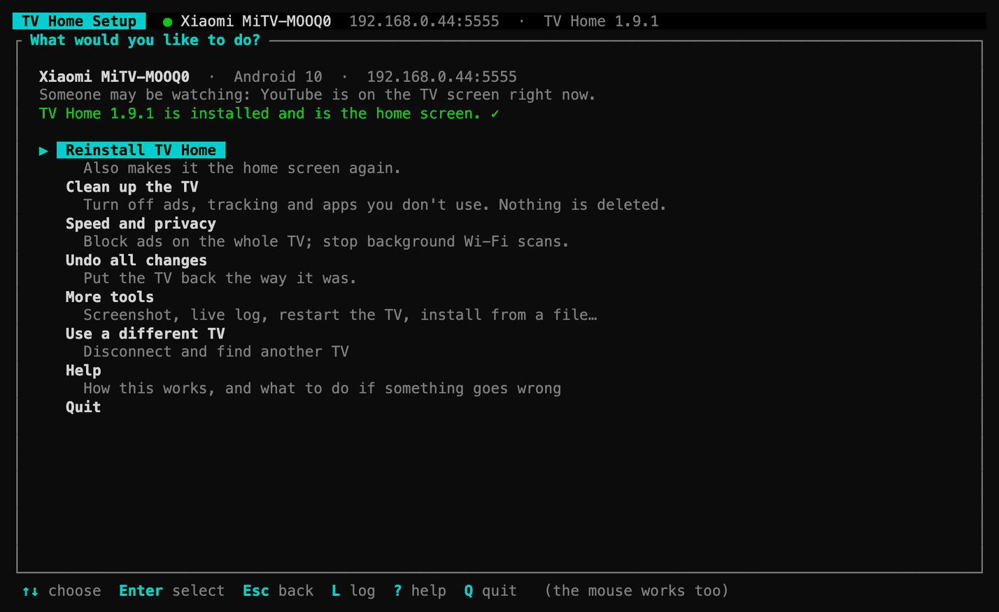

# The setup app (TUI)

`tvhome-tui` is a small app for your computer that sets up the TV for you. It guides you through it: you pick choices with the arrow keys and Enter, or with the mouse, and it tells you in plain words what it will do before it does anything.

It can:
- **set up the TV in one go** (*Set up my TV*): everything below, with a check at the end
- **find your TV** on the Wi-Fi and connect to it
- **install TV Home** (and update it later)
- **clean up the TV**: turn off ads, tracking and apps you don't use
- **block ads on the whole TV**
- **undo everything**
- **check power and send wake requests** over ADB, Wi-Fi or wired Ethernet; send standby, Home or reboot commands over ADB



You don't need to install anything else first. If your computer doesn't have Google's small helper for talking to Android devices (*adb*), the app offers to download it into its own folder.

## 1. Get the app

From [Releases](https://github.com/nullifye/MiTV-Debloat/releases/latest), under **Assets**, download the file for your computer:

| Your computer | File |
|---|---|
| Windows | `tvhome-tui-<version>-x86_64-pc-windows-msvc.zip` |
| Mac with Apple chip (M1 or newer) | `tvhome-tui-<version>-aarch64-apple-darwin.tar.gz` |
| Mac with Intel chip | `tvhome-tui-<version>-x86_64-apple-darwin.tar.gz` |
| Linux | `tvhome-tui-<version>-x86_64-unknown-linux-gnu.tar.gz` |
| Android phone, in Termux (most phones) | `tvhome-tui-<version>-aarch64-linux-android.tar.gz` |
| Android phone, in Termux (older 32-bit phones) | `tvhome-tui-<version>-armv7-linux-androideabi.tar.gz` |

The middle part of each name is the kind of computer it's built for: chip, maker, system. Linux has no single maker, so it says `unknown`.

Not sure which Mac you have? Apple menu → **About This Mac**: it says *Chip: Apple…* or *Processor: Intel…*.

Unpack it, then start it:
- **Windows:** right-click the zip → **Extract All**, then double-click `tvhome-tui.exe`. If Windows says "Windows protected your PC", choose **More info → Run anyway** (the app isn't code-signed).
- **Mac:** double-click the downloaded file to unpack it. Then open **Terminal** and run these two lines. The first lets macOS run a program from outside the App Store; the second starts it.
  ```bash
  xattr -d com.apple.quarantine ~/Downloads/tvhome-tui
  ~/Downloads/tvhome-tui
  ```
- **Linux:** `tar -xzf tvhome-tui-*.tar.gz && ./tvhome-tui`
- **Android phone:** see [Run it on your phone](#run-it-on-your-phone-termux).

The window works best quite large (about 110 × 32 characters). Make it bigger if things look cut off.

## Run it on your phone (Termux)

No computer? The app also runs on an Android phone, in [Termux](https://termux.dev) (get it from F-Droid or GitHub; the Play Store version is outdated). The phone and the TV must be on the same Wi-Fi.

1. In Termux, install adb and allow access to the phone's Downloads folder (for screenshots and support reports):
   ```bash
   pkg install android-tools
   termux-setup-storage
   ```
2. Get the app. Replace `<version>` with the newest version on [Releases](https://github.com/nullifye/MiTV-Debloat/releases/latest), for example `1.10.3`. In Termux, `uname -m` says `aarch64` on most phones (use the `aarch64-linux-android` file) or `armv7l` on older ones (`armv7-linux-androideabi`):
   ```bash
   curl -LO https://github.com/nullifye/MiTV-Debloat/releases/latest/download/tvhome-tui-<version>-aarch64-linux-android.tar.gz
   tar -xzf tvhome-tui-*.tar.gz
   ./tvhome-tui
   ```
3. Follow it as below. Tap a choice to pick it; the extra-keys row above the keyboard has Esc and the arrows. Turning the phone sideways shows more at once; upright works too, and on a long page ↑ and ↓ scroll the text.

The TV asks "Allow USB debugging?" for the phone: tick **Always allow from this computer** (the TV's words) and choose OK.

## 2. Follow it

1. **Get the helper.** If the app asks about *Android Platform Tools*, choose **Download it for me**. It takes a few seconds and goes into the app's own folder; nothing else on your computer changes.
2. **Prepare the TV.** Turn on *USB debugging* on the TV. The app's **How do I turn on USB debugging?** walks you through it.
3. **Find your TV.** The app looks for TVs on your Wi-Fi and lists them: choose yours. Not found? Choose **Type the TV's address**. On newer Google TVs that only have *Wireless debugging*, open **Pair device with pairing code** on the TV: the app lists it as *TV at … wants to pair* (or choose **My TV shows a pairing code**), then type the code.
4. **Allow it on the TV.** The TV asks "Allow USB debugging?". Tick **Always allow from this computer** and choose **OK**. The app notices by itself and carries on.
5. **Choose what to do** from the main menu. **Set up my TV** does it all in one go.

Before anything changes, you see a **"Ready to…?"** page listing what will happen. Choose **Start**, or **Cancel** to back out. **Show the exact commands** shows every command it will run. When it's finished, it tells you what to do next, for example "Press the Home button on your TV remote".

**It checks its own work.** After installing or turning apps off, the app checks that the Home button still works. If it doesn't, the app switches back on what it just switched off, so the TV is never left stuck.

The app remembers your TV, so next time it connects by itself.

**Updates:** when a newer version of this app is on GitHub, the top line says *New version …* with the download link on the main screen. TV Home on the TV tells you about its own updates in the bell (turn that off in TV Home's Settings → Notifications → TV Home updates).

## What's in the menu

| Choice | What it does |
|---|---|
| **Set up my TV (recommended)** | Everything in one go: installs (or updates) TV Home, turns off the suggested apps (see *Clean up*), and blocks ads on the whole TV if that box is ticked. One **"Ready to…?"** page lists it all first, and Home is checked at the end. |
| **Install / Update TV Home** | Downloads the newest TV Home, installs it, gives it the permissions it needs and makes it the home screen. Updating keeps your settings. On a **Google TV** (Sony, TCL, Chromecast, Hisense…) the app notices by itself and also switches off Google TV's own home screen, so Home opens TV Home. |
| **Clean up the TV** | Lists the preinstalled apps on *your* TV that are worth turning off, with a short note on each.<br>• **Ticked for you:** ads, tracking, promos and store demos that owners of at least two TVs (from [cleanyourtv](https://github.com/Gathin23/cleanyourtv)'s lists for 370+ models) turned off. Untick any you want to keep, then choose **Turn off**.<br>• **Show more apps you could turn off:** streaming apps, screensavers and other things, only if you don't use them.<br>• Apps the TV needs can't be ticked.<br>• *Show every app on the TV* lists everything, for people who know what they're doing. |
| **Speed and privacy** | **Block ads on the whole TV** (AdGuard's free ad-blocking DNS), **stop background Wi-Fi scanning**, and **stop apps waking up by themselves** (Xiaomi's PatchWall: its scheduled jobs run while you watch and can make 4K video stutter; it still opens, for the Input button's picker). **Set up my TV** does that last one too. |
| **Undo all changes** | Turns every app back on and puts every setting back, including the TV's own home screen. Tick *Also remove TV Home* to uninstall it as well. |
| **More tools** | TV power and wake, a screenshot, a live log, the phone remote's address, installing from a file, removing TV Home, restarting the TV, and **Save a support report**. |
| **Use a different TV** | Disconnects and looks for TVs again. |

**Nothing is ever deleted.** Apps are only turned off, and *Undo all changes* turns them back on. The only thing the app can uninstall is TV Home itself, and only when you choose that.

### Power and wake

Choose **More tools → TV power and wake** while connected. If the TV later stops responding, **Wake a saved TV** is available from *Find your TV*. The status reads Android's power state over ADB: **Online** means awake (including a screen saver), **Standby** means Android reports asleep/dozing, **Offline** means ADB is unreachable (not proof that the TV has no power), and **Unknown** means the reading is missing or unauthorized. The screen checks again periodically and shows the evidence behind the label.

**Wake via ADB** sends Android's `KEYCODE_WAKEUP` only when the TV is still reachable over ADB and reports Standby. This worked on the development Mi TV, even though a Wake-on-Wi-Fi magic packet did not wake it. ADB wake cannot help if the TV drops its ADB connection during standby; the network wake methods below do not need ADB.

**Standby via ADB** first checks that Android still reports Online, then sends `KEYCODE_POWER` (the remote's Power key). This put the development Mi TV into Standby and left ADB reachable; `KEYCODE_SLEEP` did not reliably keep it asleep on that TV. Because Power is a toggle, a simultaneous remote press could reverse it; the confirmation warns you. Other models may disconnect ADB in standby, so keep the physical remote nearby. If ADB drops, the app says the actual power state is unverified rather than claiming success. **Restart the TV** and **Press Home** remain under *More tools*.

For Wake-on-Wi-Fi, choose **Use detected Wi-Fi MAC** while the TV is connected over ADB; for a TV using Ethernet, choose its detected Ethernet MAC instead. Detection reads the TV's current interface (not the router's BSSID). Some TVs hide this information: enter the MAC from the TV's network settings if no detected choice appears. The MAC is saved for future wake attempts **without an ADB connection or even an ADB installation**. The app broadcasts the magic packet on the computer's local IPv4 /24, ports 9 and 7. Both devices must be on the same local network; WoWiFi only works if the TV's firmware and network settings support waking its Wi-Fi radio. Sending a packet is not proof that the TV woke. Without ADB, power-state verification shows Unknown.

MAC settings live under the chosen TV's ADB address in the app folder's `config.json`:

```json
"power": {
  "192.168.0.44:5555": {
    "wifi_mac": "02:AA:BB:CC:DD:EE",
    "ethernet_mac": ""
  }
}
```

Each wake or standby action asks for confirmation. `--dry-run` sends no keys or wake packets. Old IR/HDMI entries in `config.json` are kept when saving settings, but are no longer shown or used. On Unix the app sets `config.json` to owner-only permissions when it saves it.

## Keys

| Key | Does |
|---|---|
| ↑ ↓ | Move between choices (or scroll the mouse wheel) |
| Enter | Choose (or click) |
| Space | Tick or untick a box |
| Esc | Go back |
| L | Show everything the app did: each command and what the TV answered. Press **E** there for problems only. |
| ? | Help |
| Q | Quit (asks about USB debugging first) |

## When you're done

Press **Q**. While you're connected, the app offers **Turn off USB debugging and quit**: choose it. While USB debugging is on, anyone on your Wi-Fi could control the TV. TV Home and the phone remote keep working with it off. To use the app again later, turn USB debugging back on in Developer options.

## If something goes wrong

| Problem | Try this |
|---|---|
| No TV found | Check the TV is on, on the same Wi-Fi as the computer, and USB debugging is on. Choose **Search again**, or type the address. |
| It can't connect | Choose **Restart the connection helper**, then try again. Restarting the TV helps too. |
| The TV never asks "Allow USB debugging?" | Press Home on the TV remote and look again, then choose **Try again**. On some TVs, turning USB debugging off and on brings it back. |
| "can't be updated in place" while installing | TV Home was installed from somewhere else. The app offers to remove the old copy first. That resets TV Home's settings. |
| Home still opens the old home screen | Install TV Home again. |
| "Home didn't open TV Home" | The check at the end failed, so the app switched back on what it had switched off. The TV works as before. Restart the TV and try again. |
| Mac says the app "cannot be opened" | Run the `xattr` line from step 1. |
| Odd characters or broken lines on Windows | Use **Windows Terminal** (from the Microsoft Store). In the old console the app already switches to plain symbols. |
| You need help | **More tools → Save a support report** saves a text file in your Downloads folder with what went wrong. Attach it when you ask. |

Everything the app does is also saved in `tui.log` in its folder:
- **Mac:** `~/Library/Application Support/tvhome-tui`
- **Windows:** `%APPDATA%\tvhome-tui`
- **Linux:** `~/.local/share/tvhome-tui`

## Credits

The Clean up suggestions use the per-model debloat lists from [cleanyourtv](https://github.com/Gathin23/cleanyourtv) (MIT License, Copyright (c) 2026 Gathin). `tui/tools/import_cleanyourtv.py` turns them into `tui/catalog-cleanyourtv.toml`; this project's own notes in `tui/catalog.toml` take priority.

## For the technically curious

- **Options:** `tvhome-tui [--tv <ip[:port]>] [--adb <path>] [--repo <owner/name>] [--data-dir <path>] [--dry-run] [--ascii | --unicode] [--no-color]`.
  - With `--dry-run` (*practice mode*), every plan is shown and logged but nothing on the TV changes.
  - `--ascii` draws plain symbols (`*`, `>`, `+--+`). It's automatic in Windows' classic console (no `WT_SESSION`, `TERM_PROGRAM` or ConEmu); `--unicode` turns it off. `TVHOME_ASCII=1` does the same as `--ascii`.
  - `--no-color`, or the `NO_COLOR` environment variable, turns colours off; the selected choice shows as reversed text.
- **Which adb it uses:** an installed one first (on `PATH` or in an Android SDK), else its own copy in `<app folder>/platform-tools`. That copy is Google's *platform-tools-latest* for your system, and the app asks before downloading it.
- **Finding TVs:** it asks adb for TVs announcing *Wireless debugging* (`adb mdns services`), and checks the computer's local network (/24) for port 5555, which is network debugging. TVs adb is already connected to are listed too.
- **Each TV has its own records** in `backup/<serial>/`, keyed by the TV's serial number (its address if it has none). That's what the app turned off and the settings it changed, plus `tv.txt` naming the TV. *Undo all changes* only ever undoes what was done to that TV. Records from before this were loose in `backup/`: they move into the folder of the TV that `backup/getprop.txt` names, or of the first TV that connects if there's no such file.
- **Google TV's Home button:** Android sends Home to the Home app with the highest priority, and only between equals to the one chosen as default. Installed launchers get 0, Google TV's launcher 2 and its setup app 1. So on a Google TV (detected by its launcher, `com.google.android.apps.tv.launcherx`, being installed) installing also switches off every Home app above 0, the setup app first. There's nothing to tick. On Sony (Realtek) TVs that's also what stops a Sony system app from starting Google TV's home screen on every Home press. While Google TV's home screen is off, casting from a phone (Chromecast built-in) doesn't work; *Undo all changes* turns it back on.
- **The Home check:** after installing it presses Home and waits up to 12 s for TV Home to be in front (`dumpsys window`). After turning apps off it checks Home still resolves to a real home screen. If the check fails, it runs `pm enable` for what that plan disabled and, after an install, makes the old launcher Home again.
- **Turning USB debugging off** runs `settings put global adb_wifi_enabled 0; settings put global adb_enabled 0` in one shell command, because the connection drops as soon as the first one lands.
- **Shared with the scripts:** started from the MiTV-Debloat folder, it uses the same `backup/<serial>/` folders and `.tv` file as the bash scripts. `scripts/restore.sh` undoes what the app did, and the app's *Undo* undoes what the scripts did.
- **Building it:** the source is in `tui/` (Rust, [ratatui](https://ratatui.rs)). Run `cd tui && cargo run --release`, and `cargo test` for the tests.
